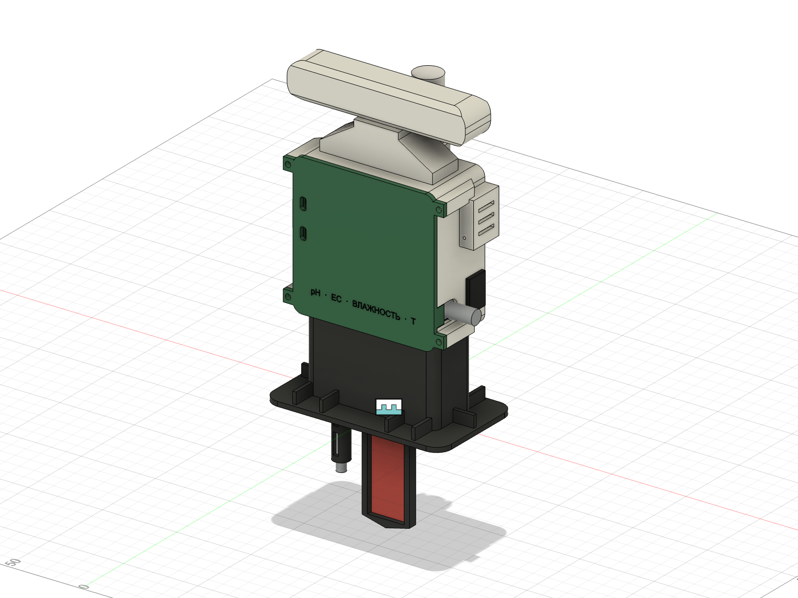
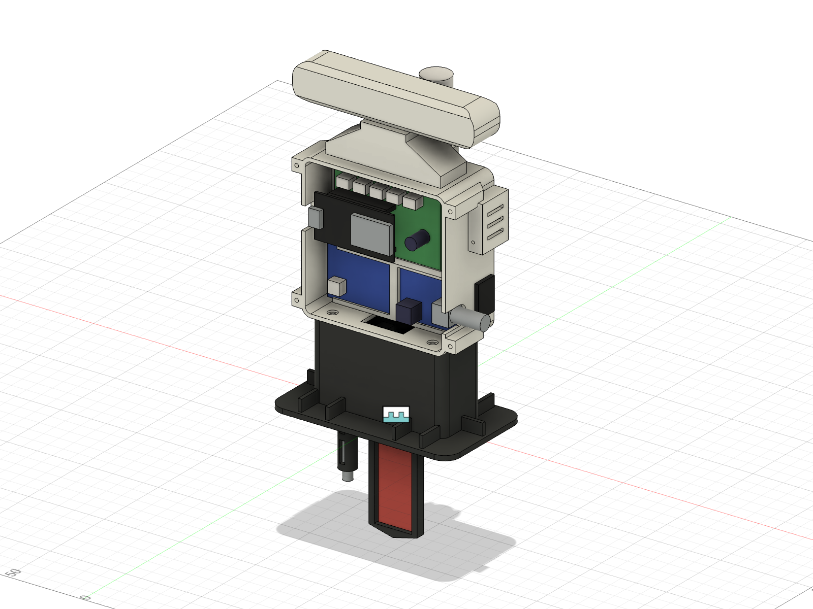

# SoilPlus Mini — ground soil probe

A handheld probe that measures soil **pH, salinity (TDS / EC), moisture and temperature** right in the field. It sends the readings over Wi-Fi to the web app five times a second.

The project answers the NASA Space Apps 2026 challenge
[*Adapting Farms with NASA Data*](https://www.spaceappschallenge.org/2026/challenges/adapting-farms-with-nasa-data/). Satellites see weather, rainfall, surface moisture and vegetation across a whole region. They cannot see soil chemistry: acidity and salt content decide which crops a field can carry in a rotation. The probe supplies that local soil information. The satellite side of the project combines it with NASA Earth observations.



## What it measures

| Parameter | Sensor | Range | How it works |
|---|---|---|---|
| **pH** | glass electrode on BNC + pH-4502C amplifier | 0–14 | The electrode makes ~59 mV per pH unit (Nernst equation). The board turns it into 0–3.3 V. Converted with a 2-point calibration in pH 7 and pH 4 buffers. |
| **Salinity (TDS)** | TDS probe v1.0 (two needle electrodes) | 0–5000 ppm | An AC current between the needles measures how well the soil water conducts. More dissolved salt means higher conductivity. Converted with the DFRobot cubic curve and corrected to 25 °C (−2 % per °C). EC (dS/m) ≈ 2 × ppm / 1000. |
| **Moisture** | capacitive sensor v1.2 | 0–100 % | The board is a capacitor whose dielectric is the soil. Water has a permittivity of ~80, dry soil ~4, so wetter soil gives a lower voltage. Mapped linearly between "dry in air" and "in water" calibration points. No bare metal, so it does not corrode. |
| **Soil temperature** | DS18B20 in a steel sleeve | −55…125 °C, ±0.5 °C | A digital sensor on the 1-Wire bus, 12-bit. Also used to correct the TDS reading. |
| Air pressure / temperature | BMP280 (I²C) | — | Wired and mounted in the case; not read by the firmware yet. |
| Battery level | voltage divider 100k/100k | 3.0–4.2 V | Wired to GPIO34; not read by the firmware yet. |

In the soil, the moisture sensor reaches **~7 cm** deep, the DS18B20 **5 cm**, the TDS needles **1.2 cm**. The pH electrode rides on the probe in two clips with its protective cap on. For a reading, you take it out of the clips and put it into a soil–water mix.

## How it works

```
 sensors ──► ESP32 ADC (12-bit, 3.3 V) ──► filtering ──► calibration ──► JSON ──► Wi-Fi ──► web app
```

1. **Sampling.** Every 200 ms the ESP32 reads each analog sensor 21 times. It sorts the samples, drops the 4 lowest and 4 highest, and averages the middle 13. This removes the spikes the Wi-Fi radio puts on the ADC.
2. **Conversion.** Raw voltage becomes physical units using the calibration stored in the ESP32's flash memory (NVS):
   - pH = 7 + (V₇ − V) × 3 / (V₄ − V₇)
   - TDS = (133.42·v³ − 255.86·v² + 857.39·v) × 0.5 × factor, where v is the voltage corrected for temperature
   - moisture % = (raw_dry − raw) × 100 / (raw_dry − raw_wet)
3. **Sending.** The ESP32 joins a phone hotspot (up to three known networks, it picks whichever is in range). It runs a **WebSocket server on port 81** and pushes one JSON message to every connected client 5 times a second:

   ```json
   {"temp": 18.62, "ph": 6.81, "tds": 412, "moist": 37, "fw": 2}
   ```

   | Field | Unit | Note |
   |---|---|---|
   | `temp` | °C | `0` means the temperature sensor is not connected |
   | `ph` | pH | |
   | `tds` | ppm | = 0.5 × EC in µS/cm |
   | `moist` | % | 0 = dry air, 100 = water |
   | `fw` | — | firmware version; 2 and above has the corrected pH scale |

   Right after a client connects, the probe also sends a `{"hello": "SoilPlus online"}` greeting. Clients ignore it.
4. **Connecting a web app.** The probe prints its IP address in Serial Monitor: `[WS] Open ws://192.168.x.x:81/`. The browser opens `ws://<IP>:81/` and receives the stream. The web app keeps a 5-second rolling median of pH and TDS, because the high-impedance pH electrode jitters by ±0.2. It reconnects automatically if the hotspot drops.
   Browsers block `ws://` from an `https://` page, so a live demo with the probe runs on `http://localhost`. The phone and laptop must be on the same hotspot.
   A ready-made client for the website, a mock probe for working without the hardware and a connection test page are in [`web-client/`](web-client/README.md).

## Calibration

Done once, through Serial Monitor (115200 baud). Values are saved in flash and survive reboots:

| Command | What to do first |
|---|---|
| `cal ph7` | electrode in pH 7.00 buffer, wait 30 s |
| `cal ph4` | rinse, electrode in pH 4.00 buffer, wait 30 s |
| `cal tds 707` | TDS probe in a solution of known ppm (here 707) |
| `cal moistdry` | moisture sensor in dry air |
| `cal moistwet` | moisture sensor in water |
| `cal show` | prints the current calibration |

Do not put the TDS probe and the pH electrode in the same water: the TDS excitation current shifts the pH reading by up to 0.8 pH.

The calibration lives in the ESP32's own flash memory, not in the website or this repository. Reflashing the firmware keeps it; only `cal reset` erases it.

**Current state of the demo board (15 Nov 2026):**

| Sensor | Calibration | Check |
|---|---|---|
| Moisture | done: dry (air) raw 2400, wet (water) raw 587 | air 1 %, water 100 % |
| Temperature (DS18B20) | none needed | 23.4 °C in the room |
| TDS | factory curve (factor 1.0), temperature-compensated | tap water ~250 ppm |
| pH | **not calibrated yet**: needs pH 4.00 and pH 6.86/7.00 buffer solutions | — |

The moisture calibration was taken with the current wiring. If the wiring changes, repeat `cal moistdry` / `cal moistwet`.

## Electronics

| Part | Role |
|---|---|
| ESP32 DevKit, 30 pin (USB-C) | microcontroller with Wi-Fi |
| LiPo 103450, 3.7 V 2000 mAh | battery |
| TP4056 (USB-C) | charger with battery protection |
| KCD1 switch | power on/off |
| MT3608 | boost converter, set to 5.0 V for the ESP32 |
| 470 µF capacitor | smooths the ESP32 supply when Wi-Fi transmits |

Power path: battery → TP4056 (B+/B−) → OUT+ → switch → MT3608 → 5.0 V → ESP32 VIN. All sensors are powered from the ESP32's 3.3 V pin.

| Sensor | Signal | ESP32 pin |
|---|---|---|
| pH-4502C | Po (analog) | GPIO35 |
| TDS | A (analog) | GPIO32 |
| Moisture | AOUT (analog) | GPIO33 |
| DS18B20 | DATA (+4.7 kΩ pull-up to 3.3 V) | GPIO4 |
| BMP280 | SDA / SCL | GPIO21 / GPIO22 |
| Battery divider | middle point | GPIO34 |

The analog sensors use only ADC1 pins (32–39), because ADC2 stops working while Wi-Fi is on. No sensor sits on the ESP32 boot pins (0, 2, 5, 12, 15).

## Enclosure



A short T-handle probe, 27 cm tall:
- the electronics block is 95 × 95 × 48 mm;
- underneath is a sensor head with a 120 × 70 mm skirt. The skirt sets how deep the probe goes and takes the push force, so the sensors do not bend.

Inside the block there are two levels:
- **front:** a deck with rails for the pH board, the TDS board and the perfboard with the ESP32;
- **back:** pockets for the battery, charger and booster, pressed in place by a frame.

In the sensor head, three screw jaws clamp the moisture sensor (inside a protective fork), the DS18B20 (in a small tripod) and the TDS probe. Everything is held mechanically, with no glue or tape.

- Designed as a parametric **Autodesk Fusion Python script**: [`hardware/SoilPlusMini/SoilPlusMini.py`](hardware/SoilPlusMini/SoilPlusMini.py). Every size is a parameter at the top of the file. Running the script rebuilds the model and checks all parts for collisions (0 found). It then exports the STL files and STEP to [`hardware/out/`](hardware/out).
- Real parts were measured with calipers; missing sizes come from datasheets. Every sliding fit has 0.3 mm clearance per side.
- Printed on a Bambu Lab A1: PLA, 0.2 mm layers, 6 walls, no supports. A test piece came first. The perfboard was snug in a 1.7 mm slot, so the deck slots are 1.8 mm (nine 0.2 mm layers, because the slot lies across the layers).
- M3 screws go straight into 2.5 mm pilot holes in the plastic and cut their own thread. No brass inserts are needed.
- Full build guide with print settings and assembly order (in Russian): [`hardware/BUILD_ru.md`](hardware/BUILD_ru.md).

## Using it in the field

1. Turn on the phone hotspot (2.4 GHz; on iPhone enable *Maximize Compatibility*), then switch the probe on.
2. With a knife or screwdriver, cut a slit for the moisture board and poke a hole for the DS18B20. Push the probe in until the skirt touches the soil and press the soil around it.
3. Open the web app on a laptop on the same hotspot and enter the probe's IP.
4. Wait ~30 s for the readings to settle. Move to the next spot.

Do not rock the probe while it is in the soil: the force should go through the handle and the skirt.

## Firmware

[`firmware/soilplus/soilplus.ino`](firmware/soilplus/soilplus.ino), Arduino IDE with the ESP32 board package.
Libraries: WebSockets (Markus Sattler), OneWire, DallasTemperature, ArduinoJson.

1. Copy `secrets.example.h` to `secrets.h` and fill in your hotspot names and passwords. `secrets.h` is in `.gitignore` and must never be committed.
2. **Disconnect all sensors before flashing.** Otherwise GPIO2 gets pulled and the chip boots into the wrong mode (`boot:0xb`). Hold BOOT until `Writing...` appears.
3. After boot, Serial Monitor shows which network it joined and its IP.

## What we did

- Picked the sensors and pins so all analog inputs work together with Wi-Fi (ADC1 only).
- Wrote the firmware:
  - noise filtering;
  - calibration stored in flash and edited live over serial (no reflash);
  - Wi-Fi with several fallback hotspots;
  - WebSocket streaming at 5 Hz.
- Found and fixed bugs while testing on the real board:
  - the pH formula had its sign reversed (a pH 4 buffer read 10). Fixed in firmware v2; the web app un-mirrors data from boards that still run v1;
  - without the temperature sensor, TDS was "compensated" to 0 °C, which doubled the reading. Now it assumes 25 °C;
  - two equal moisture calibration points caused a divide-by-zero and a reboot loop. Now guarded.
- Went through three enclosure designs: a stake, a long T-probe and the final short **SoilPlus Mini**. Each pass got simpler and lighter, and the pump was dropped.
- Audited the design for printing and assembly, then printed a test piece and tuned the slot width from the real print.
- Printed the main body and fitted the battery, charger and booster into their pockets.

## Known limitations

- **TDS needs re-checking.** One module read higher in air than in water, possibly damaged by reversed polarity. A salt-water test is planned.
- The probe measures salinity in the soil water around the needles. FAO crop salt-tolerance tables use ECe (saturated-paste extract). A reading in more diluted soil water comes out lower than ECe, so comparing it with FAO limits is approximate and can underestimate salinity.
- BMP280 and battery level are wired but not read by the firmware yet.
